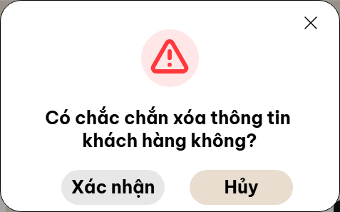

# G10 — Execution lượt tiếp tục đến gate G11

14/11/2026, hoàn tất kiểm thử lúc 17:39 giờ Việt Nam. **G10 IN PROGRESS / G11 chưa đủ điều kiện bắt đầu.** Không tự nghiệm thu hoặc miễn trừ các cổng còn mở theo yêu cầu “chạy đến khi phase11 kết thúc”.

## Kết quả cuối thực thi

| Gate | Kết quả |
|---|---|
| `npm.cmd run lint` | PASS, exit 0 |
| `npm.cmd run typecheck` | PASS, exit 0 |
| `npm.cmd test -- --maxWorkers=1` | **514 PASS / 0 FAIL / 0 SKIP / 0 TODO**, 28 file, 153,33 giây |
| `npm.cmd run build` | PASS, exit 0; còn cảnh báo chunk >500 kB |
| `npm.cmd run test:e2e -- --workers=1` | **166 PASS / 0 FAIL / 0 SKIP / 0 FLAKY**, 564,45 giây |
| `npm.cmd run test:visual:local -- --workers=1` | **8 PASS / 0 FAIL / 0 SKIP / 0 FLAKY**, 18,78 giây |
| Static local-only audit | **5/5 PASS** |
| Source/test/config guard | **191 file không đổi** trong lượt cuối |
| `git diff --check` | PASS |
| G10 CI/Linux/Pages đúng SHA mới | NOT RUN; chưa commit/push G10 |
| G11-T01–T05 / nghiệm thu G10 | Chưa đủ đầu vào; không báo PASS hoặc DONE |

Lệnh thực thi có thêm reporter/log JSON để lưu bằng chứng, không thay nội dung test. Không cộng lại các targeted run vào full; 13 unit mới đã nằm trong 514, hai E2E mới đã nằm trong 166. [Execution/hash guard](evidence/customer-visual/final/execution.json), [từng ca Chromium](evidence/customer-visual/final/chromium-tests.json), [từng ca unit](evidence/customer-visual/final/unit-tests.json), [8 visual](evidence/customer-visual/final/local-visual-tests.json). Log tương ứng trong cùng thư mục.

## Đã sửa và kiểm chứng

- Popup xóa khách hàng đúng khung 477px, spacing/typography/icon theo PDF CODEX, border không bị mờ do translate nửa pixel. Tám modal xác nhận/chặn xóa/thành công/lỗi cho Chủ và Nhân viên đạt geometry/pixel G10-D02; không mask hoặc thay nguồn.
- Class riêng chỉ áp cho luồng xóa. Hai E2E mới đã tái hiện lỗi CSS lan sang thông báo sửa (2 FAIL trước sửa) và PASS sau cờ state deletion; không đổi nội dung hoặc nghiệp vụ sửa/xóa.
- Bổ sung 13 unit về sửa rỗng/sai định dạng/trùng phone, race hai hồ sơ, reopen, và chặn xóa purchase-only/sale-only độc lập. UI mới cả hai role kiểm lỗi sửa không ghi, Hủy, rename giữ MaKH/phone/marker và reload.
- Regression kiểm lại approval/rejection, đóng popup, phân quyền/session hai tab, đồng bộ không F5, giá snapshot, kho, tiền/QR/điểm, report legacy verified-only và transaction/rollback. Đây là kết quả ca thực thi, không chứng nhận đủ mọi nhánh/visual của 27 UC/98 BR.
- Review assertion riêng 23 BR thuộc auth, khách hàng, hàng hóa/scheduler; [ledger 98 BR](evidence/audit/br-assertion-review-ledger.json) ghi phần còn lại chưa review trong lượt này. Không thay acceptance phase trước hoặc mở lại bảng Hàng hóa 5 cột.
- README đã bỏ tiến độ G6-T02 lỗi thời; chuẩn bị checkpoint schema/release/known issues cho G11, không triển khai vượt dependency.

Lượt full trước sửa có **162 PASS/2 FAIL** do oracle centered của test cũ không đúng vị trí cụm nút trong PDF: hai nút cách tâm frame +10px. Đã sửa kỳ vọng sang tọa độ source và đo control thật, giữ dung sai 1px; không bỏ test/nới pixel threshold. Tám visual ban đầu cũng FAIL và được giữ trong báo cáo lịch sử, không đổi thành PASS hồi tố. [Chi tiết trước/sau](CUSTOMER_VISUAL_EXECUTION.md).

## Ảnh sau sửa

| Chủ cửa hàng | Nhân viên |
|---|---|
|  |  |
| [Xóa thành công](evidence/customer-visual/final/owner-delete-success.png) | [Xóa thành công](evidence/customer-visual/final/staff-delete-success.png) |
| [Có lịch sử, không được xóa](evidence/customer-visual/final/owner-delete-linked.png) | [Có lịch sử, không được xóa](evidence/customer-visual/final/staff-delete-linked.png) |

Ảnh chỉ là vùng modal runtime trong profile test, không phải full-screen verdict. [Chỉ mục/hash 19 ảnh runtime gốc](evidence/customer-visual/final/screenshots.json); các alias ở bảng trên sao chép đúng ảnh actual. PDF/expected/diff/cache nguồn khác SC105 vẫn riêng, ngoài Git.

## File của lượt này

Source: `src/components/ui/ConfirmDialog.tsx`, `ResultDialog.tsx`, `src/features/customers/CustomerDetailPage.tsx`, `src/index.css` (chỉ hunk khách hàng). Test: `tests/e2e/confirmation.spec.ts`, `phase10-customer-edit.spec.ts`, `tests/unit/customer-edit.test.ts`, `tests/visual/customer-dialogs.local.spec.ts`. Config: `playwright.visual.config.ts`, `package.json` (script), `tsconfig.json` (include), `.gitignore` (cache nguồn). README và các báo cáo/ledger được cập nhật. [Danh mục cả G10 và file ngoài phạm vi](FILES_CHANGED.md).

Không đổi schema, production service, trạng thái/quan hệ legacy, workflow hoặc quyền deploy. Bảo toàn hunk CSS bán hàng/`sales-draft.spec.ts` và file root/CODEX đã có từ trước.

## Git, Pages và bước tiếp theo

Fetch cuối: main/HEAD/origin-main cùng `1fd4ad4a04e3b870a1c673fd7abd344af50dea69`, 0 ahead/behind, staging trống. Chưa có commit mới; chưa push/deploy. Theo AGENTS, quyền Git đã có nhưng scope G10 chưa đủ gate nên chưa đến mốc commit phase.

[Run GitHub hiện tại](https://github.com/thuytrangmai66-oss/50K142.03.3007/actions/runs/43537965540) là SHA G9 trên, E2E failure và deploy skipped. Pages URL trả HTTP 200 không chứng minh đã chạy G10 hoặc smoke release; quyền/config Pages chưa xác minh qua API không xác thực. [Chi tiết checkpoint](RELEASE_READINESS.md).

Tiếp tục kiểm chứng SC/BR còn lại; các quyết định Q21/SLA/thiết bị thật và ngoại lệ SRS/Figma cần chủ dự án chốt theo [gói review](G10_REVIEW_GATE.md). G11 giữ T01→T05 và chỉ thực thi khi đủ gate; không tự đánh dấu hoàn tất để chuyển phase.

Local: `cd D:\50K142-NEW\CoCo`, `npm.cmd run dev`, mở **http://127.0.0.1:5173/50K142.03.3007/**. Không xóa storage; hai tab cùng origin dùng dữ liệu chung và đăng nhập độc lập. [Hướng dẫn demo](../../README.md).
